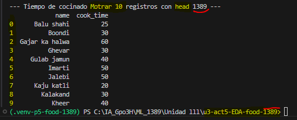
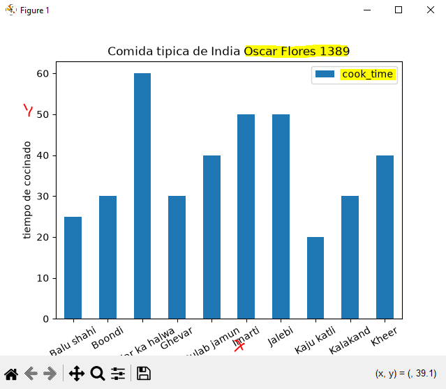
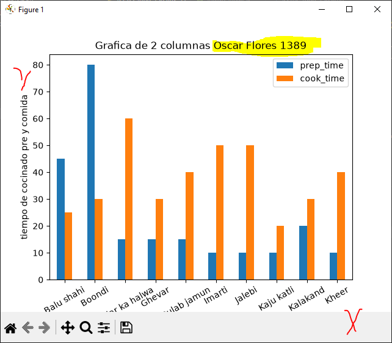
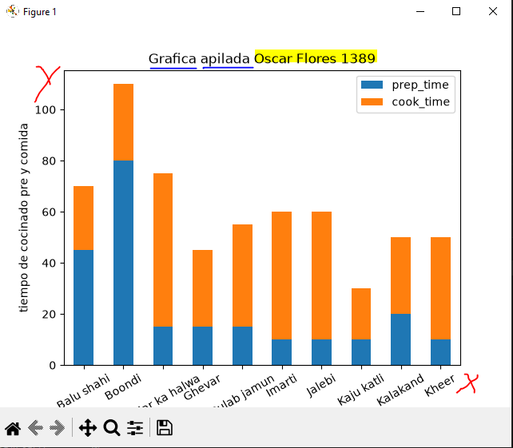

## Analisis exploratorio de datos
## Comida del pais India
## Oscar Flores NC 1389
### -+-+- importando datos del csv comida de india 1389

## -+-+- Mostrar Nombre de comida + ingredientes 1389

## -+-+- Tiempo de cocinado 1389

## -+-+- Creacion de grafica de barras 1389

## -+-+- Creacion de grafica de 2 columnas 1389

## -+-+- Grafica apilada 1389
